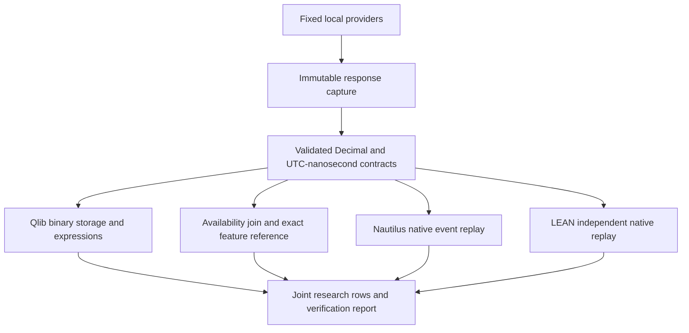

# Joint research framework

`futu_bridge.joint` is a read-only composition layer for the existing Qlib,
NautilusTrader, LEAN, and ML implementations. It gives applications one Python
API and CLI while preserving separate runtimes and fixed local Futu/Polymarket
providers. Trading remains manual. There is no execution capability in its
public interface.

## Implementation decisions

| Function | Selected implementation | Reason and boundary |
|---|---|---|
| Provider access and immutable capture | Existing local API and capture format | Preserve source selection, permissions, response bytes, and hashes |
| Historical event replay | Nautilus first, LEAN if unavailable | Existing exact-decimal native bars and event callbacks; backend selected before work starts |
| Independent replay verification | LEAN | A separately implemented C# reader checks the same timestamps, decimals, calendars, and custom probability data |
| Compact batch storage | Qlib | Retains the existing CSV/bin workflow and compatible research environment |
| Batch expressions | Qlib plus shared gap policy | Use native `Ref` and `Mean`; explicitly mask warm-up after session/missing-bar gaps |
| Feature correctness reference | New Decimal implementation | Independently check Qlib's float32-derived features against original provider values |
| Futu/Polymarket time alignment | New shared implementation | Join on availability, reject ambiguous duplicates, preserve token IDs, and enforce maximum staleness |
| Continuous HK.00700 data | LEAN default; Nautilus fallback/selectable | Both passed native tick/reconnect checks; LEAN had lower observed local callback delay |
| ML research | Existing scikit-learn baseline | Retain chronological splits, label purging, portable model files, and manual review |

These are suitability decisions for the implemented workloads, not a claim that
one framework is universally fastest. Full-process wall times include different
startup/conversion work and are recorded without ranking unlike operations.
The tested versions remain Qlib 0.9.7, Nautilus 1.231.0, and the pinned LEAN
commit documented in [platform-converters.md](platform-converters.md).

Qlib and the reference implementation currently share three minute features:
one-step close return, close/mean-of-five minus one, and high-low range/close.
A gap other than exactly one minute resets the trailing window. Values lacking
enough history stay null. The Qlib result must agree with the independent
Decimal reference within **2e-6 absolute error**. This tolerance applies to
dimensionless features only; native engine OHLCV/timestamps still require exact
agreement, and original source prices remain exact.

## Architecture and contracts



`Bar`, `Probability`, and `Dataset` are frozen dataclasses. Decimal values must
be finite; OHLC ranges and signs must be valid. Timestamps are integer UTC
nanoseconds. Outcome IDs remain digit strings, including IDs too large for a
floating-point representation. A manifest and every referenced response are
hash-checked before use. Each run copies only those files to its own snapshot
and revalidates them. Output directories must be new and outside the input
capture, preventing accidental overwrite and recursive copying.

Historical bar availability follows the explicit capture start/end convention;
probability availability is bucket end. Neither is proof of original receipt
time. `history` requires `allow_retrospective=True` / `--allow-retrospective`.
This prevents a retrospective replay from silently masquerading as certified
point-in-time data.

The join chooses the latest probability whose availability is **at or before**
the bar's availability. It rejects duplicate token/availability pairs. The age
limit is inclusive; observations older than the limit become null. There is
no interpolation or backward filling from future observations. The combined
output has one row per bar with exact OHLCV, shared features, and outcome
values/availability/age.

## Python API

```python
from pathlib import Path
from futu_bridge.joint import JointResearch, RuntimePaths

research = JointResearch(RuntimePaths.local(Path("F:/test")))
report = research.history(
    Path("F:/test/output/platform_compatibility/capture_20261102_03"),
    Path("F:/test/output/joint/new-history-run"),
    allow_retrospective=True,
    verify_all=True,
    max_age_seconds=120,
)
```

`RuntimePaths` can also be constructed with explicit executable/source paths
on another machine. Importing the joint package starts no service and imports
none of the optional engines. Frameworks execute in their own environments,
so installing a new framework does not upgrade Qlib's dependencies.

`history(..., verify_all=True)` requires all three runtime prerequisites.
With `verify_all=False`, the capability policy can select an available replay
engine and fall back from Qlib features to the exact reference. An explicitly
requested backend is never replaced. A conversion error, crash, malformed
completion report, or data mismatch propagates as a failure; it does not
trigger fallback to hide the error. Historical failures write `status.json` and
retain stage logs. Success is published atomically only after all checks pass.

## CLI

Run from the repository root with the existing prepared environments:

```powershell
# Same immutable real capture through both replay engines and Qlib.
.\.venv-qlib\Scripts\python.exe -m futu_bridge.joint history `
  --capture output/platform_compatibility/capture_20261102_03 `
  --output output/joint/new-history-run --allow-retrospective

# Continuous HK.00700 data through the selected native live client.
.\.venv-qlib\Scripts\python.exe -m futu_bridge.joint live `
  --output output/joint/new-live-run

# Bounded live verification, including converter-only reconnection.
.\.venv-qlib\Scripts\python.exe -m futu_bridge.joint live `
  --output output/joint/new-live-check --seconds 60 --disconnect-after 15

# Choose Nautilus explicitly: add --backend nautilus to either live command.
# Reproduce the daily model using the saved real provider response.
.\.venv-qlib\Scripts\python.exe -m futu_bridge.joint model `
  --output output/joint/new-model-run `
  --response output/ml/hk00700_baseline_20261105/provider_response.json `
  --start 2020-01-01 --end 2026-11-04
```

Create a `STOP` file in the live output's `nautilus` or `lean` subdirectory to
stop gracefully. A bounded run invokes the independent native-tick verifier;
quiet/closed markets cannot pass as fresh live activity. Continuous shutdown
does not claim fresh activity was verified. Reconnects can leave unknown trade
gaps because the provider has no replay contract. Full depth and last-price-only
events remain in the raw journal; native callbacks represent trades and BBO.

Historical outputs include `input/`, per-engine artifacts/logs,
`reference_features.json`, `features.json`, `joined.json`,
`research_rows.json`, `status.json`, and `report.json`. The model method saves
the unchanged baseline's artifacts under `model/`. Minute cross-provider
features are not silently injected into the HK daily model; that needs a
separately defined training dataset and availability policy.

## Coding standard and test cases

See [joint-coding-standard.md](joint-coding-standard.md) for the enforceable
rules and validation commands. Tests remain local under
`futu_bridge/tests/test_joint.py`, following the existing preference to exclude
new test files from GitHub updates. Their cases are documented here:

| Area | Required cases |
|---|---|
| Contracts | Frozen objects; Decimal finiteness; no float substitution; valid OHLC; no boolean timestamps; exact IDs; valid provenance |
| Alignment | No future observation; inclusive age boundary; stale/missing nulls; duplicate bars/outcomes rejected |
| Features | Independent symbols; rolling warm-up; gap resets; future data cannot alter past features |
| Selection | Preferred backend; unavailable-runtime fallback; explicit request rejection; no execution capability |
| Isolation | Lazy imports; separate runtime paths; output cannot be nested in source capture |
| Failure | Backend crash records failure and never silently switches; tampered raw response rejected |
| Artifacts | Atomic report publication; invalid JSON report type rejected |
| Real integration | Both native replays, Qlib storage/expressions, joint row alignment, portable ML, fresh HK.00700 live ticks and reconnects |

No provider code or original Qlib exporter is modified. Historical coverage is
currently raw US one-minute equities and Polymarket outcome history. Live
coverage is HK.00700 trades/BBO. Options, news, full-depth native mapping,
execution, and a certified point-in-time history remain outside this version.

## Verification on November 9, 2026

The combined historical run passed with 1,560 real AAPL/MSFT minute bars and
5,760 real Polymarket outcome observations captured for November 2-3. Both
native engines preserved all values and timestamps exactly. Qlib's shared
feature error against the exact reference was at most `1.523e-7`, below the
declared `2e-6` bound. All 1,560 combined research rows were independently checked
against the original probability observations for identity, availability and age.
An actual run with unavailable Nautilus/Qlib paths also passed using LEAN replay
and reference features, confirming the fallback path with real market data.

After Futu was opened, fresh HK.00700 feeds were checked for 60 seconds with a
forced converter-only disconnect after 15 seconds:

| Live run | Fresh trades | BBO updates | Fresh trades after reconnect | Median local callback delay |
|---|---:|---:|---:|---:|
| Nautilus before queue improvement | 70 | 318 | 61 | 9.47 ms |
| LEAN | 72 | 327 | 57 | 0.39 ms |
| Nautilus after queue improvement | 74 | 365 | 53 | 1.31 ms |

The Nautilus converter previously polled every 10 ms. It now awaits a bounded
blocking-queue read in a worker, so arrival wakes processing without blocking
the event loop. The new run again passed exact native values/timestamps,
reconnection, complete queue draining and zero orders. Runs cover different
start/stop boundaries; timings are observations, not latency guarantees.
Book timestamps remain provider observation times, not exchange timestamps.

All 144 Python regressions passed, including 20 new joint contract tests, as did
three native JavaScript tests. After the queue change, the 33 relevant joint/live
contract tests passed again. The nine-module structural coding gate passed.
The ML method reproduced the existing daily baseline; it does not establish a
new predictive edge. Generated evidence stays local:

- `output/joint/verification_20261109.json`: combined evidence and source hashes.
- `output/joint/final_20261109/`: all three frameworks and combined rows.
- `output/joint/fallback_20261109/`: real-data fallback run.
- `output/joint/live_lean_20261109/lean/verification.json`: fresh LEAN stream.
- `output/joint/live_nautilus_improved_20261109/nautilus/verification.json`: improved live converter.
- `output/joint/model_20261109/model/report.json`: reproduced ML evaluation.

Design references: [Qlib data layer](https://qlib.readthedocs.io/en/latest/component/data.html),
[Nautilus architecture](https://nautilustrader.io/docs/latest/concepts/architecture/),
and the pinned [LEAN source](https://github.com/QuantConnect/Lean/tree/49b4aa7022abd38e99e9c7d3ec67929fa7f6d7b8).
Installed version source and actual runtime checks govern the adapters; latest
documentation is architectural context, not an assumption of API compatibility.
