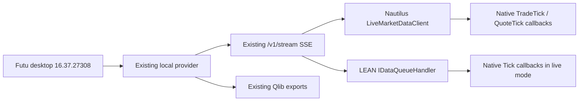

# Continuous HK.00700 feeds

The existing Futu desktop provider and local HTTP API stay fixed. These
converter-owned integrations consume its native SSE push stream; they do not
poll REST quotes, add a market-data source, or change the Qlib exporter. The
existing Polymarket provider is also unchanged.



## Start and stop

Use the already prepared runtimes described in
[platform-converters.md](platform-converters.md): NautilusTrader 1.231.0 on
Python 3.13, the separate Qlib 0.9.7 environment, and local .NET SDK 10 with
LEAN source commit `49b4aa7022abd38e99e9c7d3ec67929fa7f6d7b8`.
Keep Futu signed in and the existing service running at `http://127.0.0.1:8765`.

From the repository root:

```powershell
# Runs continuously; prints the new output directory.
& .\scripts\run_live_platforms.ps1

# Repeatable bounded live test, including one disconnect per converter.
& .\scripts\run_live_platforms.ps1 -Seconds 120 -DisconnectAfter 35
```

The script compiles only the converter addition into the existing local LEAN
checkout, then launches both engines. `-SkipBuild` reuses that build; use it only
when `lean_live.cs` has not changed. `-OutputRoot` accepts a new directory and
`-ProviderUrl` accepts a loopback HTTP URL. No QuantConnect CLI, account, hosted
data subscription, or additional data API key is needed. Existing Futu session
permissions still determine the data available.

To stop gracefully from another PowerShell window, substitute the directory
printed by the runner:

```powershell
$run = 'F:\test\output\live_platforms\run-YYYYMMDD-HHMMSS'
New-Item -ItemType File -Path "$run\nautilus\STOP" -Force
New-Item -ItemType File -Path "$run\lean\STOP" -Force
```

Each converter closes its own SSE connection, drains pending callbacks, and
writes `run.json`. The provider remains running. A bounded run automatically
performs exhaustive verification and fails if fresh market activity is absent.
A continuous run stops without claiming such a test passed: retained logs may
have rotated, and closed-market operation may contain no trades.

To inspect a short, unrotated capture independently:

```powershell
.\.venv-qlib\Scripts\python.exe -m futu_bridge.converters.live_verify `
  --output "$run\nautilus"
.\.venv-qlib\Scripts\python.exe -m futu_bridge.converters.live_verify `
  --output "$run\lean"
```

Add `--require-reconnect` for a run made with `-DisconnectAfter`.

## Mapping and recovery

| Provider data | Native platform data | Timestamp policy |
|---|---|---|
| Fresh trade prints | Nautilus `TradeTick`; LEAN trade `Tick` | Exchange timestamp, milliseconds preserved |
| Complete top-of-book bids/asks | Nautilus `QuoteTick`; LEAN quote `Tick` | Provider observation time, explicitly labeled |
| Initial snapshots / backfill | Raw journal only | Never counted as new live trades |
| Full depth and last-price-only quotes | Raw journal only | No fabricated trades or BBO |

Trade IDs remain exact strings. The last 100,000 IDs are retained for duplicate
suppression across reconnects; revisions are flagged rather than emitted as
new fills. This bounded cache does not promise deduplication across process
restarts or beyond its retention window. Nautilus uses `NO_AGGRESSOR` because
the provider's tick direction is not a verified aggressor classification.

Both transports retry HTTP/stream failures with bounded backoff, detect a
stalled read after 20 seconds, and reconnect after provider gap notices. Each
consumer queue is bounded at 8,192 entries; overflow is recorded as a failure.
Disconnects do **not** provide exchange replay or guarantee lossless recovery.
The forced-disconnect test closes only each converter's HTTP connection; it
does not restart or modify Futu or the local service.

Each platform folder contains `raw.jsonl`, `admitted.jsonl`, `callbacks.jsonl`,
`transport.jsonl`, connection-state `transport_status.json`, and final
`run.json`. JSONL journals retain a current segment of about 32 MiB and three
older segments. Full-capture verification deliberately refuses rotated logs.
Inspect the last raw/callback timestamp for data freshness; connection-state
snapshots are written on transitions, not on every tick. Engine stdout/stderr
are retained separately by the runner.

Trading is manual. Both live and historical observers submit no orders, and
platform tests cover data delivery and accuracy only. Nautilus has no execution client. LEAN uses
its local paper brokerage and live data-feed engine. Instrument price precision
and lot settings preserve data; they are not verified HK trading rules. LEAN
uses a pass-through calendar with Hong Kong data time, not a certified HK
exchange holiday/session calendar. Execution and portfolio accounting are
outside this data-feed test.

## Verified on this machine

On **2026-11-05 during the HK afternoon session**, both actual live engines ran
for 120 seconds against Futu **16.37.27308**, with one forced disconnect after
35 seconds:

| Check | NautilusTrader | LEAN |
|---|---:|---:|
| Fresh trade callbacks | 190 | 189 |
| Best bid/ask callbacks | 633 | 631 |
| Fresh trades after reconnect | 129 | 129 |
| SSE connections | 2 | 2 |
| Live orders | 0 | 0 |
| Native decimals and timestamps match source | Exact | Exact |
| Admitted updates delivered before shutdown | All | All |

The engines connect independently, so small count differences at their start
and stop boundaries are expected. Verification compares each engine with its
own original provider responses. It checks native object values, native
timestamps, leading-zero symbol identity, unique trade IDs, fresh exchange
activity, and delivery after reconnect. Book timestamps remain observation
times because the provider supplies no exchange timestamp for them.

Local receipt-to-callback median was 8.98 ms for Nautilus and 0.41 ms for LEAN.
Observed exchange-to-callback median was about 0.93 s and 0.92 s respectively.
These are measurements of this run, including provider delay and clock
differences, not a speed comparison or a latency guarantee.

A separate continuous-mode run stopped through STOP files and delivered all
138 trades / 422 quotes in Nautilus and 138 trades / 423 quotes in LEAN.
Historical replays still pass for all three platforms: 1,560 US equity bars
and 5,760 Polymarket probabilities. Qlib's original daily dataset still loads.
All 115 Python tests and three native JavaScript tests passed. Tracked provider
files and the original Qlib exporter match the repository baseline.

Local evidence (generated output is ignored by Git):

- `output/live_platforms/verified_20261105/{nautilus,lean}/verification.json`
- `output/live_platforms/continuous_stop_20261105/{nautilus,lean}/verification.json`
- `output/live_platforms/compatibility_after_live/verification.json`

Implementation: `futu_bridge/converters/nautilus_live.py`,
`lean_live.cs`, `lean_live.py`, and converter-side `live_source.py`.
`live_verify.py` independently compares source records with framework callbacks.
