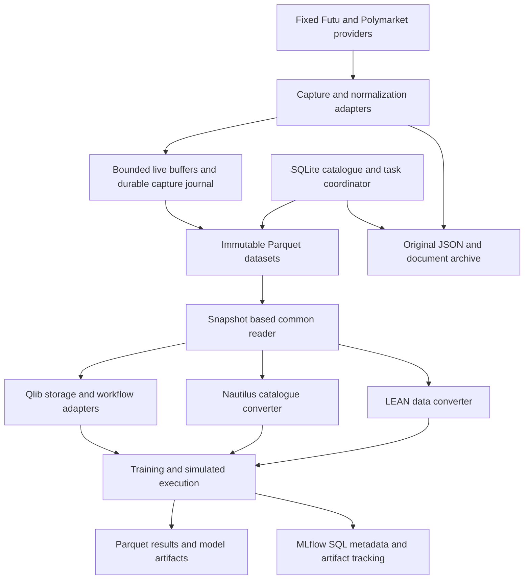

# Parquet development plan for the joint research framework

Date: 2026-11-09. Implementation update: 2026-11-10.
The immutable storage foundation now includes version histories, durable capture
journals, replay cursors, compaction and rollback. Native Qlib Parquet ML/RL parity,
MongoDB-free local task training, and the common costed research workflow have
passing component evidence. Further verified additions include 29 native learner
classes, MetaModelDS, online scheduling, task clock/retry hardening, 37 native
Nautilus indicators, typed provider fields and interrupted-process recovery in
both native execution engines. Final integration gates also cover multi-capture
lineage, independent daily simulation audits and task backup/restoration.
See the [operator guide](parquet-operations.md), [Qlib adapter](qlib-parquet.md),
[task workflow](qlib-parquet-tasks.md), and [native order matrix](native-order-coverage.md).
These are implementation milestones, not a declaration of full upstream coverage.
The [release status](parquet-release.md) distinguishes implemented scope from
remaining engineering, operation, data and optional-dependency gates.

Make Parquet the canonical analytical store for the joint framework. Adapt Qlib's
storage and workflow integration to it, remove the requirement for a running
MongoDB service, and finish the remaining framework capabilities through explicit
acceptance gates. Preserve working native algorithms and select or merge equivalent
implementations only after correctness and performance comparisons.

Parquet will hold market history, features, predictions, simulation journals and
task-history exports. Embedded SQLite will coordinate mutable task state and
dataset publication. Original documents and model checkpoints remain files.
This is one storage interface with clearly assigned ownership for each kind of
record. It does not require a MongoDB or Redis service.

## Scope and fixed constraints

- Keep the local Futu and Polymarket providers, their APIs, authentication and
  original runtime unchanged. All acquisition uses those existing interfaces.
  Preserve the current free market-data sources and fallback policy.
- Keep Qlib, NautilusTrader, MLflow and Python workers in `.venv-joint`. LEAN
  retains its existing .NET runtime and uses that same Python installation when
  executing Python algorithms. Do not create framework-specific environments.
- Start with the existing 211-distribution lock: Python 3.12.16, Qlib 0.9.7,
  NautilusTrader 1.231.0, MLflow 3.18.0 and PyArrow 25.0.1. Treat any later
  dependency change as a separately tested update to the common lock.
- Use real captured or newly observed market data. Orders, fills and accounts
  are simulated only. Keep live observation separate from execution; no broker
  routing client may be constructed by a simulation workflow.
- Preserve HKD 100,000, long-only, no leverage and IBKR Pro tiered fees as the
  default HK.00700 experiment configuration. Version the fee schedule and its
  effective date; verify official rates before a new cost-comparison release.
- Keep the original Qlib CSV/bin exporter and existing datasets usable. Treat
  newly generated native-format datasets as reproducible conversion outputs.
- Follow the [coding standard](joint-coding-standard.md): typed contracts,
  documented behavior, explicit errors, immutable evidence and independent
  numerical checks. Preserve applicable upstream notices for adapted code.
- Keep executable test files and private market captures local, following the
  repository's existing publishing policy. Publish test-case descriptions and
  suitable verification summaries. No commit or push is part of this plan.

## Initial baseline before this plan's implementation

The table below records the initial November9 baseline, not the latest release
status. A historical passing report certifies its exercised source and
configuration; it does not certify later edits to the same files.

| Area | Existing evidence | Remaining work |
|---|---|---|
| Shared runtime and legacy Qlib | [Runtime contract](shared-runtime.md), existing bin readers and shared replay | Recheck the current tree and bind new evidence to source and lock hashes |
| Qlib native RL and execution | [Simple RL](native-qlib-rl.md), [nested HK execution](native-execution.md) | Feed both from Parquet without changing learning or simulator semantics |
| Cross-engine order lifecycle | [390 simulated scenarios](../output/joint/lifecycle_extended_final_20261109/report.json) | Preserve this baseline while extending behavior and persistence |
| Qlib features and models | [Passing feature report](../output/joint/qlib_features_final_20261109/report.json): Alpha158/360, eleven model configurations, rolling workflows and portfolios | Broader model catalogue, cross-sectional workflows, task coordination, caches and continuous scheduling |
| Nautilus | [Catalogue and features](../output/joint/nautilus_features_verified_20261109/report.json), [35 contingent-order runs](../output/joint/nautilus_contingent_verified_20261109/report.json) | Partial-parent activation, full simulation recovery and remaining native capability families |
| LEAN | [Earlier native framework run](../output/joint/lean_features_final2_20261109/report.json), [clean Python host exit](../output/joint/lean_features_python_host_probe2_20261109/host.json) | Current [combined run failed](../output/joint/lean_features_integrated_20261109/status.json); optimizer and QuantBook paths need repair |
| MLflow | [Passing local service and registry report](../output/joint/mlflow_features_final_20261109/report.json) | Dataset snapshot lineage, scheduler reconciliation, sustained service recovery |
| Common selection and coverage | `performance.py`, `coverage_runner.py`, `capabilities.py` exist | Combined feature and final performance report paths referenced by the inventory do not exist |

MongoDB binaries were downloaded, but startup did not become operational. The
Mongo-backed `qlib_features_tasks.py` has no successful integration report.
The development path below does not depend on resolving that server problem.

## Storage architecture

Only the capture adapters call providers. Framework readers consume frozen
snapshots or explicitly subscribed live streams. Dataset identity is independent
of the framework that reads it.

| Storage component | Authoritative contents | Update policy |
|---|---|---|
| Parquet datasets | Normalized observations, revisions, features, labels, predictions, simulated events and analytical task history | Immutable files; publish a new snapshot |
| Original archive | Exact provider responses, news/report/PDF bytes and extraction inputs | Address by content hash; retain original bytes |
| `control.sqlite` | Committed snapshot membership, heads and replay cursors | Short transactions; no long-running model work inside a transaction |
| `tasks.sqlite` | Task states, claims, monotonic leases, retries and recorder outbox | Separate coordinator schema; fenced results and crash-released reconciliation locks |
| Existing MLflow SQL store | Experiments, runs, model versions, aliases and metrics | MLflow owns its schema and migrations |
| Artifact files | Native model weights, RL checkpoints and generated framework caches | Hash and associate with dataset and run IDs |

Keep MLflow's database separate from `control.sqlite`, even though both initially
use SQLite. This avoids coupling our schema migrations to MLflow's internals.
MLflow's supported metadata backends are SQL-based; Parquet is not a drop-in
replacement for its tracking backend. [MLflow backend stores](https://mlflow.org/docs/latest/self-hosting/architecture/backend-store/)

Parquet and Arrow do not supply transactional dataset publication or task claims.
Readers must use committed file lists, not discover whatever files happen to be
present in a directory. [Arrow dataset transaction limitations](https://arrow.apache.org/docs/python/dataset.html#a-note-on-transactions-acid-guarantees)

### Data contracts

Extend the existing exact-decimal contracts without silently changing their
meaning. Add typed records for bars, trades, BBO, depth snapshots, instruments,
calendars, corporate actions, Polymarket events/markets/outcomes, probability
observations, document versions, extracted features and simulated execution.

Every applicable record carries:

- Stable instrument/event/outcome identity; keep Polymarket token IDs as strings.
- Source event time, actual receipt time when observed, ingestion time, and the
  time from which research is allowed to use the record. Retain UTC nanoseconds,
  source timezone and local trading date. Unknown historical receipt times stay
  null; a retrospective availability convention is labeled explicitly.
- Provider and endpoint identity, capture hash, schema version, source sequence
  when supplied, revision identity and data-quality flags.
- Price/quantity units, currency, adjustment mode and field-specific precision.
  Preserve source precision with validated Arrow decimal types or scaled integers;
  reject overflow or silent truncation. ML float arrays are derived views.
- For bars, explicit interval start/end and completion status. For depth, identify
  snapshots versus deltas and preserve all supplied levels and source ordering.

Store observed event descriptions and resolutions as versions, not overwritten
current truth. Keep probability prices distinct from realized outcomes. Store
event categories, popularity measures and LLM judgments with their observation
time, prompt/configuration hash, model identity and status. Reuse the existing
DeepSeek configuration and retry policy; never store its credentials in datasets.

All point-in-time joins require both event-time constraints and availability
constraints. Training labels may use future outcomes only in the label pipeline;
they cannot enter features. Revised prices, corporate actions and later event
resolutions must not leak backward into an earlier research snapshot.

### File layout and ingestion

Use a new ignored local storage root, leaving existing `output/` evidence intact.
Initial layout: `raw/`, `parquet/<family>/`, `manifests/`, `control.sqlite`,
`artifacts/`, `exports/<framework>/<snapshot>/`, and `staging/`.

Partition by data family and market, then month for low-volume daily/event data
or trading date for higher-volume ticks/depth. Sort analytical rows by instrument,
event time and deterministic source sequence. Avoid an event-ID directory per
Polymarket market. Final partition granularity, compression and row-group sizes
must come from the benchmark, with small current datasets allowed to stay small.

Define idempotency keys per data family. Bars and event revisions have different
identity rules from trades and depth messages. Prefer provider IDs/sequences;
otherwise preserve capture-session and message-ordinal identity. Identical prices
or payload hashes alone cannot distinguish a duplicate delivery from two valid
trades. Mark ambiguous cross-session overlap instead of discarding real activity.
Explicitly merge/order records when replaying across files; directory discovery
order is not a market-event sequence.

The capture journal records complete messages before they are advertised as
durable. Start with configurable group commits targeting one second or 10,000
messages, whichever arrives first; these are tuning defaults, not a latency or
power-loss guarantee. Report the last durable sequence and the uncommitted range.
An optional flush-per-message mode can trade throughput for a smaller loss window.
Compact journal segments into Parquet in batches. Do not write one file per tick.

Use bounded queues and observable backpressure. If persistence cannot keep up,
record the gap or stop the affected capture with an explicit failure. Do not
silently drop observations or block the unchanged provider's internal threads.
Reconnection may recover data through an existing history endpoint only where
that endpoint actually supplies it; unreceived depth/tick history stays missing.

### Publication and recovery protocol

1. Write uniquely named staged files on the target filesystem. Close them, validate
   footer/schema/counts and hashes, and flush according to the durability policy.
2. Finalize immutable filenames before publishing their references. Test Windows
   rename/sharing behavior and retry bounded transient failures without deleting
   the previous snapshot.
3. In one SQLite transaction, insert file membership, provenance, watermarks and
   the new committed snapshot pointer. Use an expected-generation check to prevent
   conflicting publishers from silently replacing each other's work.
4. Readers pin a snapshot ID for an entire run. A new capture or compaction cannot
   change the file set underneath an active model or simulation.
5. Recover incomplete staging and unreferenced finalized files after a crash.
   Validate all referenced files; missing or corrupt committed data fails closed.
   Never represent file operations and SQL updates as one filesystem transaction.
6. Compaction and corrections publish replacement snapshots. Garbage collection
   respects active readers, retained experiments, backups and a grace period.

Maintain independent backups of committed files, original documents, metadata and
model artifacts. Use SQLite's backup facilities or a controlled checkpoint/close
procedure; copying only a live database file can omit its journal. Test restoration
into a new directory. A second directory on the same disk is not disk-failure protection.

## Reimplementing Qlib for Parquet

Qlib's data backend and its MongoDB task manager are separate concerns. Its local
data providers expose configurable storage classes; its native `TaskManager`
stores task definitions, states and results in MongoDB.
[Qlib data layer](https://qlib.readthedocs.io/en/stable/component/data.html),
[Qlib task management](https://qlib.readthedocs.io/en/stable/advanced/task_management.html)

Reimplement the persistence and orchestration boundaries. Retain Qlib's expression
operators, processors, model algorithms, trainers' learning callbacks, portfolio
logic and RL algorithms wherever they already work. Any copied/adapted functions
must identify the pinned upstream source and preserve its license notice.

### Calendar instruments and features

Implement `ParquetCalendarStorage`, `ParquetInstrumentStorage` and
`ParquetFeatureStorage` against the installed Qlib storage interfaces. Wire them
through explicit Qlib configuration in isolated workers, without editing
`site-packages` or replacing global classes for unrelated consumers.

Preserve calendar indexing, inclusive/exclusive slice behavior, start/end indices,
instrument lifetimes, missing values, frequency selection and deterministic index
order. Handle HK lunch breaks, nontrading sessions and the existing bar timestamp
convention explicitly. Extend calendar versions without invalidating an already
pinned run's integer feature indices. Mutating storage methods produce a new
snapshot through the coordinator; they never edit published Parquet files in place.

First compare primitive reads with the original bin backend, then `D.features`,
Alpha158/360, `DataHandlerLP`, `DatasetH`, model predictions and native simulations.
Keep exact source decimals in canonical storage; reproduce Qlib's existing float32
view where required and declare tolerances before comparing numerical results.
Preserve the distinction between a generic Qlib rolling expression and the joint
feature contract that resets windows at gaps.

For RL, add snapshot readers to the existing data and execution adapters. Keep
native simple and nested simulator observations, actions, rewards, termination,
fees and checkpoint behavior unchanged. Validate the day/30-minute/1-minute
hierarchy and the existing HK state-adapter correction separately.

The old bin backend remains a selectable compatibility path and differential
reference. Parquet is the canonical dataset; a bin export is a versioned cache,
not a second independently edited source of truth.

### Caches and point in time data

Build Parquet expression/dataset caches keyed by snapshot, instrument universe,
expression AST, frequency, adjustment mode, availability cutoff, processor-fit
interval, relevant source hashes and runtime versions. Preserve data-handler
MultiIndex/column metadata. Concurrent writers publish once; stale or incomplete
cache entries never masquerade as valid results.

Use native expression evaluation initially. Retain the existing vectorized
`FiniteByDate` implementation only with native semantic parity. Introduce bounded
in-memory column/window caching to avoid a disk scan for each expression request.
Replace Redis-dependent cache coordination for these local workflows; do not claim
compatibility with Redis's protocol or multi-machine service until separately tested.

Add publication-aware fundamentals/universe readers only when the fixed providers
or original captures contain the necessary dated information. Current constituents
or today's revised fundamentals are not historical point-in-time evidence.

### MongoDB free task management

Implement a converter-owned `ParquetTaskManager` facade with a transactional
`SQLiteTaskStore`, plus `ParquetTrainerRM`, `ParquetDelayTrainerRM` and the task
runner glue. The name describes the research workflow's Parquet datasets and
history; active claims are deliberately stored in SQLite.

Parquet contains task-history snapshots and tabular results. SQLite is authoritative
for pending/running task state. Opaque model/checkpoint objects remain hashed
artifacts referenced from both. MLflow recorders remain native MLflow objects.

Preserve the following installed Qlib 0.9.7 contracts:

| Contract | Required replacement behavior |
|---|---|
| Task creation | Definition deduplication, input-order ID results, empty input and `dry_run` behavior |
| Claiming | Atomic selection within a pool, higher-priority-first behavior and exactly one current lease |
| Lifecycle | Normal and staged execution through `waiting`, `running`, `part_done` and `done`; preserve valid `run_task` before/after-state combinations, including repeated stages |
| Failure rollback | `safe_fetch_task` returns the task to its prior eligible state and re-raises the exception |
| Queries and administration | `query`, `re_query`, `task_stat`, `list`, `prioritize`, `replace_task`, insert, remove and reset operations |
| Results | Definition/result round trips, recorder identity, stable external IDs and native result ordering |
| Trainers | `train`, `end_train`, `worker`, `skip_run_task`, begin/end tags and delayed-training callbacks |
| Collection and online work | Existing recorder collectors, rolling task generation, model promotion and prediction updates consume equivalent outputs |

Inventory every public method and every task-query form used by pinned trainers,
collectors and online managers before replacing them. Provide typed support for
nested equality, ID lists, status and priority filters, then the other observed
operators. Unsupported queries must raise a documented error. Arbitrary PyMongo
collection access is not automatically supported by a Qlib workflow adapter.
Track any such caller explicitly instead of silently weakening its query.

Use stable typed serialization for task fingerprints. Include dataset snapshot,
training configuration and implementation identity in task definitions so revised
data cannot reuse an old completed task. Preserve opaque trusted local objects
where native Qlib needs them, with type/version/hash checks on their artifacts.

For concurrency and recovery:

- Use a short `BEGIN IMMEDIATE` transaction to claim a task and increment its
  fencing token. Commit before training. Conditional heartbeats and result commits
  must match the current owner/token; an expired worker cannot publish a result.
- Keep attempt/error history and bounded retries with backoff. Add cancellation,
  timeouts and terminal failure as explicit extensions to Qlib's four native
  states. Native-compatible exception rollback remains independently testable;
  permanent failures make `wait` terminate with an error rather than hang forever.
- Recover abandoned tasks after lease expiry. Handle machine restart and clock
  changes explicitly. Do not reclaim healthy work just because a model is slow.
- Expect at-least-once execution after a crash. Guarantee one accepted result
  through fencing and idempotent publication, not an impossible exactly-once
  guarantee for arbitrary Python side effects.
- Store result artifacts before committing their references. Use an outbox and
  reconciliation for MLflow tags and Parquet history exports. Those systems do
  not share a transaction; repeated reconciliation must be safe.
- A replacement or reset invalidates outstanding claims. Preserve native visible
  behavior for the supported task contract, and document deliberate stronger
  recovery/concurrency behavior separately from upstream equivalence.

Use the bundled SQLite runtime, currently 3.53.1, on a local filesystem. WAL mode
allows concurrent readers with a serialized writer; configure busy timeouts,
bounded retries, checkpoints and tested durability settings. SQLite WAL cannot
be shared directly between hosts through a network filesystem.
[SQLite WAL concurrency and constraints](https://www.sqlite.org/wal.html)

The first release supports multiple workers on this PC. A later coordinator API
can own SQLite on one host and issue leases to remote workers without sharing the
database file. Multi-host operation remains a separate acceptance gate requiring
real separate hosts, artifact transfer, reconnection and version checks. Local
multi-process tests alone do not close Qlib's distributed-cluster capability.

Production acceptance must pass with no MongoDB listener and with Mongo client
creation rejected in the replacement workflow. Keep the existing pinned `pymongo`
package if Qlib imports it; an installed library is not a running service dependency.
Do not patch or uninstall upstream modules merely to make an import test pass.

Verify fidelity using the pinned source's state-transition specification and
native serial/delayed trainers' model/recorder outputs. Where an isolated native
MongoDB reference can be run, compare full task traces too. Until then, report
source-contract conformance and real SQLite concurrency evidence separately from
MongoDB differential evidence; mocks cannot certify MongoDB behavior.

## Remaining capability work

Each row expands into source-level cases for the pinned versions. A feature is
complete only when its joint entry point, documentation, behavioral cases and
real-data evidence exist. An import, wrapper or declared family name is insufficient.

| Workstream | Required development | Acceptance evidence |
|---|---|---|
| Qlib models and processors | Enumerate remaining native model families, ranking/ensemble models, processors and tuning interfaces; preserve native training where compatible | Real train/validation/test splits, changed weights, prediction alignment, save/reload and independent metrics for each supported configuration |
| Qlib cross-sectional research | Multi-stock panels for MetaModelDS, selection strategies and enhanced indexing; point-in-time universes and risk inputs | Valid cross-sectional metrics, no survivor/look-ahead leakage, dated factor/covariance/benchmark inputs; no fabricated IC |
| Qlib online workflows | Durable rolling schedule, idempotent incremental predictions, model promotion/rollback and restart | Repeated scheduling does not duplicate accepted tasks/results; restarted workflow matches uninterrupted reference |
| Qlib analysis | Extend native numerical reports and expose remaining report families | Native metrics match independent formulas; visual reports trace to the same values |
| Nautilus storage and indicators | Map common snapshots to native catalogue schemas; enumerate remaining indicators and aggregation variants | Exact timestamp/value round trips, formula parity, warmup/reset and lunch-gap cases |
| Nautilus order semantics | Repair partial-parent bracket activation; complete supported order types, triggers, TIF and latency combinations | No unfunded/oversized child orders, overfills or duplicate fees; journal/account checks for each case |
| Nautilus recovery | Restore or deterministically reconstruct simulated books, cash, positions, working orders, contingencies, timers and queued commands | Separate-process interruption at partial fill/cancel/amend stages matches uninterrupted replay |
| Nautilus composition and accounting | Broader Actor/Strategy/execution-algorithm composition, multi-instrument portfolio/risk and native reports | Common event contract plus native-specific expected behavior; explicit data prerequisites |
| LEAN optimizer | Fix objective/result schema mismatch and parameter mapping in current local optimizer path | All generated combinations evaluated, optimum matches independent validation-only selection, failures retained |
| LEAN research and Python | Fix QuantBook lifecycle/transaction-manager probe; finish the shared-Python host path and docs | Native History/pandas output matches source; no irrelevant order access in research-only mode; clean shutdown and no surviving owned processes |
| LEAN Algorithm Framework | Broaden universe, Alpha/Insight, portfolio, risk, execution, History, indicators and consolidation coverage | Native lifecycle callbacks, expiry/warmup behavior, targets, simulated accounts and independent expected outputs |
| LEAN remaining execution | Remaining pinned order types, expiry/amendment behavior, fee/fill and multi-asset models | Per-engine journals and accounting; preserve legitimate native differences instead of forcing identical fills |
| MLflow | Stable tracking lifecycle, dataset lineage, model registry, alias promotion/rollback, local serving and task reconciliation | Snapshot/code/lock hashes on every run, artifact reload, schema rejection, crash recovery and alias restoration |
| Common contracts and provider fields | Map every exposed provider field, including options, news and event metadata, to supported/unsupported schemas | Coverage inventory and raw-to-normalized round trips; no silently discarded fields |
| Corporate actions and settlement | Dated splits/dividends, FX, calendars and settlement rules when real inputs exist | Independent cash/share ledger and event ordering on real dated cases; missing inputs remain explicit gaps |
| Polymarket and documents | Version discovery metadata, probabilities, resolutions, text and extraction outputs; preserve popularity/category/LLM filter stages | As-of queries and reproducible filter decisions; sports exclusions, revised-event and resolution-leakage cases |
| Joint configuration and selection | Typed native configuration entry points and comparable strategy/feature contracts | Explicit unsupported options, reproducible backend selection, no runtime fallback hiding a failed engine |

Optional packages such as Plotly, XGBoost, CatBoost or tuning libraries must not
silently create another environment or disrupt the shared lock. Decide per
capability whether a compatible common dependency update, an independently verified
faithful implementation, or an explicit blocked status is appropriate. A different
algorithm with a similar name is not a faithful replacement.

The current daily capture lacks a verified turnover scale, so observed VWAP
remains unavailable. Existing imputation does not close that data gap. Similarly,
snapshot depth cannot certify lossless order-level queues. Obtain additional
eligible data through fixed providers when possible; otherwise retain the gap.
Paid/cloud-only deployment features and real brokerage routing are outside the
local, free-data, simulated-execution release scope and must be listed separately.

For Nautilus recovery, first implement deterministic reconstruction from a pinned
snapshot, command journal, seeds and virtual-clock events. Compare at the recovery
boundary before proceeding. This is a joint recovery facility, not a claim that
native `Trader.save()` persists the entire simulated exchange. Optimize with
checkpoints only after full replay is correct. Preserve pending delayed commands
and the exact position in the event sequence.

## Delivery sequence and acceptance gates

| Phase | Deliverables and dependencies | Exit gate |
|---|---|---|
| P0 Stabilize the baseline | Inventory current changes and pinned capabilities; fix LEAN optimizer/research blockers; reconcile evidence paths; finish combined runner and docs | Current source passes shared-runtime, structural/local tests, 390-case lifecycle regression and a combined feature run; no absent evidence presented as passed |
| P1 Build the storage foundation | Versioned schemas, capture journal, Parquet reader/writer, SQLite catalogue, manifests, migration importer and backup tooling | Exact real-data round trips; deterministic snapshots; duplicate/correction handling; interruption, disk-failure and restore cases pass |
| P2 Adapt Qlib data and caches | Calendar/instrument/feature storage, expression/dataset caches, bin compatibility and RL readers on P1 | Original-vs-Parquet feature/model/replay parity; native simple and nested RL run from Parquet with matched semantics |
| P3 Replace Mongo task workflows | Task store/facade, normal/delayed trainers, leases, retries, collectors and MLflow outbox on P1/P2 | Multi-process real-data training, worker-kill recovery and stale-result rejection pass with no MongoDB service |
| P4 Complete a common research workflow | One snapshot through all converters, Qlib ML/RL, native simulated execution and MLflow | Reproducible HK.00700 comparison with versioned fees, independent ledgers and the same eligible observations |
| P5 Close native execution gaps | Nautilus partial contingencies/recovery, remaining order cases, LEAN native framework/research/optimizer integration | Pinned order/state matrix passes per engine; resumed and uninterrupted simulations agree where semantics are equivalent |
| P6 Expand research coverage | Broader models, indicators, multi-asset/panel workflows, event/documents, online scheduling and analysis | Each capability has real-data evidence or a specific dependency/data blocker; multi-host tasks require a separate-host test |
| P7 Optimize and release | Correctness-qualified selection benchmarks, compaction tuning, migration cutover and operator guide | Performance evidence is reproducible; old workflows remain usable; rollback/restore works; release report matches current source |

P0 is the first executable milestone. P1 schema design can proceed alongside P0,
but storage cutover waits for a trustworthy baseline. P5 and P6 can progress
independently after their storage and contract prerequisites pass. Estimate effort
after P0 enumerates the remaining methods and data prerequisites; do not promise a
date for unavailable market history or optional upstream integrations.

### Planned implementation boundaries

Use small modules under `futu_bridge/joint/storage/` for schemas, snapshots,
catalogue transactions, capture journals, Parquet I/O, migration and validation.
Use `futu_bridge/joint/workflows/` for the task-store interface, SQLite coordinator,
Qlib task/trainer adapters and reconciliation. Keep Qlib storage adapters in a
dedicated module with explicit worker configuration.

Extend `JointResearch`, its CLI, `coverage_runner.py`, `capabilities.py` and
`performance.py` through those interfaces. Add commands for ingesting existing
captures, listing/verifying snapshots, creating derived exports, task inspection,
backup/restore and verification. These are planned commands, not existing CLI APIs.

Every capability record must include pinned upstream version, integration mode
(native/adapted/reimplemented), supported parameters, input requirements, source
hashes, test cases, evidence path and remaining limitations. Verify that a report
exists, passes and matches the current implementation before labeling it verified.

## Real data and test cases

Use immutable existing captures first:

| Capture | Purpose and limits |
|---|---|
| `output/joint/model_20261109/model/provider_response.json` | 1,683 HK.00700 daily sessions for features/models; no verified raw VWAP |
| `output/joint/qlib_native_rl_data_20261109/provider_response.json` | 6,289 raw bars, 6,270 accepted continuous minutes across 19 sessions for nested RL and execution |
| `output/joint/shared_live_20261109/nautilus/raw.jsonl` | 96 captured ten-level depth snapshots; not lossless exchange deltas |
| `output/joint/shared_history_final_20261109/input` | Existing cross-framework equity/Polymarket alignment capture; verify source manifest and coverage before import |

Hash original input bytes and retain rejected records with reasons. Historical
compatibility cases may reuse the existing November 2-6 holdout, but model-quality
claims must identify that reuse. Reserve a later untouched real interval for final
research evaluation. Multi-stock and corporate-action tests need additional real
coverage; do not generate fictitious securities or price history to claim closure.

| Case | Exercise | Required result |
|---|---|---|
| S01 Round trip | Import actual OHLCV, probabilities and depth; query selected fields/time ranges | Exact identities/times/decimals, same null masks, documented exclusions |
| S02 Duplicate delivery | Deliver captured messages twice and overlap a historical backfill | Known duplicates are idempotent; legitimate repeated trades and ambiguous overlaps are preserved and labeled |
| S03 Revisions and as-of | Ingest two observed versions and query before/after availability | Earlier queries cannot see later revisions or resolutions |
| S04 Calendar boundaries | HK lunch/overnight/holiday gaps, daily bars and US timezone transitions present in real captures | No fabricated bars, correct completion/availability times and stable ordering |
| S05 Writer interruption | Kill the converter during journal, file finalization and manifest publication | Old committed snapshot remains usable; partial/unpublished data is not exposed |
| S06 Storage failures | Inject disk-full, permission, locked-file and corrupt-footer failures while processing real captures | Explicit failure, preserved prior data, actionable recovery and no false success |
| S07 Concurrent readers | Train/read snapshot A while appending or compacting into B | A remains byte-identical; B becomes visible only after commit |
| S08 Schema evolution | Add an optional field and attempt an incompatible type/scale change | Old snapshots remain readable; incompatible changes require explicit migration |
| S09 Restore | Restore catalogue, Parquet, raw files and artifacts into a new location | All hashes and a complete replay match the original run |
| Q01 Data parity | Bin and Parquet primitive reads, calendar slices and native expressions | Same ordering/missingness and predeclared float tolerances |
| Q02 Training parity | Alpha158/360, processors and representative native models | Identical split boundaries; training-only fits; equivalent predictions and reload |
| Q03 RL parity | Native PPO/DQN with simple and nested execution on the same episodes/seeds | Equivalent observations/rewards/done flags and fee/account audit; RNG/checkpoint continuation verified |
| T01 Task contract | Duplicate definitions, dry run, priorities, reset, replacement, query and ordering | Documented Qlib-visible behavior and deterministic supported extensions |
| T02 Competing workers | Two and four real-training workers claim the same pool | One current lease per task; one accepted result; all expected tasks accounted for |
| T03 Worker death | Kill after claim, during training and after artifact write but before commit | Bounded recovery; orphan artifacts identifiable; no duplicate accepted model |
| T04 Stale worker | Resume an expired worker after its task is reclaimed | Fencing rejects stale heartbeat/result; winning result remains unchanged |
| T05 Delayed tasks | Execute preparation, `part_done`, final training and recorder collection | Native callbacks, stage results, tags and recorder order preserved |
| T06 Exhausted retries | Transient and permanent failures, cancellation and hung worker | Transient recovery; permanent failure terminates wait; all attempts recorded |
| T07 No Mongo dependency | Run all replacement workflows with no service and reject Mongo client construction | Training, queries, recovery and task-history exports still pass |
| E01 Existing lifecycle | Repeat all 390 cross-engine scenarios from the same capture | Previous expected journals/accounting preserved within declared native differences |
| E02 Partial brackets | Partial parent, cancellation, partial exit and sibling amendment | Child exposure never exceeds available position; no unprotected-state misreporting |
| E03 Simulation restart | Interrupt with active GTC orders, partial fills and delayed cancel/amend | Recovered state and subsequent journal match uninterrupted execution |
| E04 LEAN completion | Native optimizer, QuantBook, C# and shared-Python algorithms | Correct optimum/data, clean exit and no leaked worker processes |
| M01 Tracking recovery | Interrupt result publication and model promotion | Reconciliation preserves lineage; aliases and artifacts are consistent |
| L01 Live capture | At least one HK.00700 session with fresh updates, lunch boundary and forced reconnect | Observed throughput/lag, durable watermarks and gap report; zero real orders |
| J01 Full workflow | Shared snapshot -> features -> training -> three simulated engines -> reports | Independent ledger, fees, provenance and model artifacts agree with contracts |

Failure injection changes process/storage conditions or simulated order commands,
not the recorded market prices. Small structural boundary tests may supplement
these cases, but must be labeled separately from real-data validation. A closed
market or a stream without fresh observations is not a passing live-data test.

For each simulated run, independently reconstruct fills, cash, holdings and fees
using Decimal arithmetic. Retain the current distinction between actual captured
depth and bid/ask/liquidity assumptions derived from real minute prices. Partial
fill capacity and latency assumptions must be visible in the report. Never claim
historical exchange queue accuracy from candles or depth snapshots.

## Choosing and merging implementations

Benchmark equivalent functions, not whole frameworks with different work. Begin
with storage scans, Qlib expressions versus fused NumPy features, native versus
vectorized processors, indicators, aggregation and framework conversion costs.
Keep native simulators selectable because their supported semantics differ.

1. Fix input snapshot, output schema, warmup/gap rules, precision, CPU threads,
   random seeds and memory limits. Exclude candidates that fail correctness or
   lack required semantics before timing them.
2. Run isolated, rotated-order trials with warmups and at least eleven measured
   repetitions for short kernels. Separate conversion/startup time from steady
   processing and report median, spread, memory and bytes read/written.
3. Compare cold/new-process and warm-cache runs honestly. Do not call a new Python
   process an OS-cold filesystem benchmark. Use real observed throughput for live
   latency; accelerated replay is a separate stress test.
4. Benchmark Parquet partitioning, row groups and supported compression against
   current JSON/bin/native-catalogue workflows. MongoDB benchmarking is not a
   prerequisite for a Mongo-free architecture. Do not assume Parquet beats Qlib's
   specialized bin representation on every query.
5. Select an implementation only for the workload where it wins repeatably without
   material regressions. Keep the incumbent when timing differences are noise.
   A merged function must pass the same independent reference checks.
6. Store a selection profile bound to dataset characteristics, implementation and
   converter hashes, schemas, common lock, machine and benchmark configuration.
   Invalidate stale profiles. Never switch semantics after a runtime failure.

Performance gates are zero correctness regressions, bounded memory, no unexplained
message loss and sustainable ingestion above the measured provider rate with
documented headroom. Set numerical latency/throughput targets after P0/P1 baseline
measurements; no current milliseconds or speedup ratio is asserted.

## Migration and completion criteria

Import existing raw captures into a new root without overwriting them. Verify
read parity before enabling Parquet for new workflows. Run old and new readers
against pinned snapshots, then switch the default storage selection. Continue to
support legacy bin exports and an explicit legacy reader for reproduction.
Rollback changes the selected reader/snapshot; it does not require deleting new
data or restoring modified provider code.

For every milestone, record input and provider hashes, source-tree fingerprint,
lock/interpreter identity, schema/snapshot IDs, simulation assumptions, test counts,
failures, independent verification and report paths. Recheck the entire provider
boundary and shared environment, rather than only two top-level source files.

The first Parquet release is complete when P0-P4 and their regressions pass:
one canonical store, working Qlib data/RL adapters, Mongo-free local task workflows,
all three native simulated execution paths, MLflow lineage and usable rollback.
It must still list the P5/P6 gaps. The later coverage release additionally requires
their acceptance cases and P7; do not mark `full_feature_coverage` true while a
required capability is blocked, partial or supported only by old evidence.

Use a versioned coverage denominator covering the pinned open-source capabilities,
with real brokerage and paid/cloud services separately excluded by requirement.
Report tested scope and blockers instead of an unsupported completion percentage.
The documented method inventory, real-data tests and current evidence determine
completion; changing the storage format alone does not close framework gaps.
