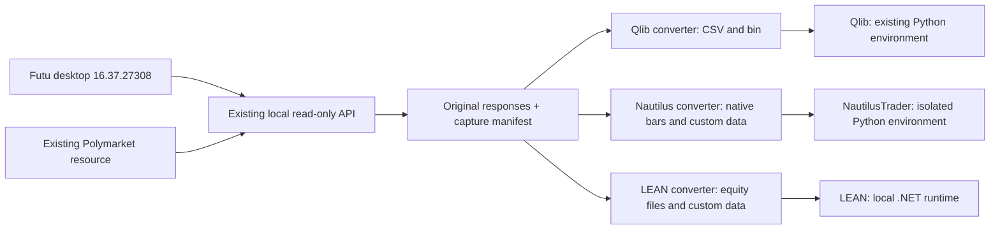

# Fixed providers, platform-specific converters

The existing local Futu and Polymarket providers are the data boundary. Their
implementations, APIs, schemas, source selection, and the old Qlib exporter are
unchanged. Each platform has its own converter and runtime. A platform does not
replace a provider or require another market-data subscription.



`futu_bridge/converters/capture.py` only reads the existing loopback routes.
It saves the original response bytes and SHA-256 hashes. The three converters
consume the same capture. Shared validation checks the provider responses; it
does not introduce a replacement provider schema. Importing the bridge or the
converter modules does not import Qlib, Nautilus, or Frida, or connect to a feed.

## Actual local verification, November 5, 2026

The test used AAPL and MSFT for **November 2–3, 2026**, with raw one-minute
regular-session bars. The Polymarket event was **Presidential Election Winner
2028**, specifically the Yes and No outcomes of **Will JD Vance win the 2028
US Presidential Election?**. The capture manifest preserves the full outcome
token IDs, market ID, metadata, request URLs, provenance, and provider warnings.

| Platform | Version tested | Futu bars | Probability observations | Result |
| --- | --- | ---: | ---: | --- |
| NautilusTrader | 1.231.0, Python 3.13.18 | 1,560 | 5,760 | All timestamps and decimal values match engine callbacks; zero submitted orders |
| LEAN | 2.5.0.0, source commit `49b4aa7022abd38e99e9c7d3ec67929fa7f6d7b8`, .NET SDK 10.0.403 | 1,560 | 5,760 | All timestamps and decimal values match engine callbacks; zero submitted orders |
| Qlib | 0.9.7, existing Python 3.11.9 environment | 1,560 | 5,760 | Calendars and values match Qlib's float32 representation |

Qlib's maximum observed price rounding error was approximately **0.00003047**;
probability rounding error was below **0.000000030**. Volumes matched exactly
in this dataset. Qlib deliberately stores float32, so its verification is
different from the exact decimal checks for Nautilus and LEAN.

The original daily Qlib dataset at `output/qlib_data/futu_day` also remains
readable through the unchanged `examples/read_qlib_futu.py`. The regression
suite passed **115 Python tests** (including historical and live converter regressions)
and **3 JavaScript tests**. Both Python environments passed dependency checks.

Evidence on this machine:

- `output/platform_compatibility/capture_20261102_03/manifest.json`: shared input.
- `output/platform_compatibility/data_only_20261105/verification.json`: combined result,
  source hashes, framework reports, and local provider health after testing.
- `output/platform_compatibility/data_only_20261105/{nautilus,lean}/engine_rows.json`:
  values recorded by actual engine callbacks.
- `output/platform_compatibility/data_only_20261105/qlib/verification.json`: Qlib numerical
  error by field and outcome token mapping.
- `output/platform_compatibility/verified/legacy_qlib_read.log`: old daily data.

These are actual historical ingestion/replay tests using the local providers.
They are not profitability tests, a speed comparison, a full historical data
coverage audit, or validation of live brokerage execution. No live orders or
new DeepSeek requests were made. No additional market-data providers were added.

## Conversion details

### NautilusTrader

`futu_bridge.converters.nautilus` targets the **stable 1.231.x API**. The 2.x
release candidate has a different Python API and is rejected explicitly by
this converter. Keep its dependencies in `.venv-nautilus`; do not upgrade the
Qlib environment to meet Nautilus requirements.

Futu rows become native `Equity`/`Bar` objects. Nine decimal price places retain
source precision; this is simulation precision, not a verified exchange order
tick size. Integer-valued volumes such as `1234.0` become integer share
quantities; fractional volumes are rejected for this Equity converter.

Polymarket history becomes custom data keyed by the exact outcome token string.
The history timestamp and conservative bucket-end delivery time are separate.
The probe uses the actual backtest engine to replay data and checks every
callback. It submits no orders and verifies that the engine's order count
remains zero. Trading is manual; simulated and live execution tests are outside
this project's scope. No live data/execution client is constructed by this
historical observer.

### LEAN

`futu_bridge.converters.lean export` creates local LEAN equity minute ZIP files
and Polymarket custom-data CSVs. The C# reader is `lean_algorithm.cs`, included
in the Python wheel and copied into a separate LEAN source checkout for the
test build. This does not edit the provider project or require QuantConnect CLI,
a QuantConnect account, an API key, Docker, or a paid data download.

The converter changes Futu bar labels into LEAN bar-start timestamps in
`America/New_York`, using its DST rules. It preserves fractional scaled price
values accepted by LEAN's decimal reader, rather than rounding prices to four
decimal places. LEAN runs with raw normalization and fill-forward disabled.
Corporate-action factor files and historical ticker mappings are not invented.

The open-source LEAN checkout supplies its market-hours and symbol-properties
reference files, whose hashes are recorded. No external benchmark subscription
is used. A constant benchmark is only part of the integration probe.

LEAN caps backtest end dates at yesterday. A history bucket ending at today's
midnight would otherwise be lost. Therefore the converter requires the day
after the capture end date to be in the past. The initial November 3–4 probe
detected this limitation; its incomplete result is preserved separately in
`output/platform_compatibility/lean`. The final shared November 2–3 capture
passes without dropping or backdating those observations.

The source build reports upstream NuGet dependency vulnerability warnings,
including high/critical advisories. They are preserved in `lean-build.log`.
Successful offline compatibility checks are not a security clearance for a
production deployment. This change does not alter upstream dependencies.

### Qlib

`futu_bridge.converters.qlib` delegates Futu CSV conversion to the unchanged
`futu_bridge.qlib_export.export_responses`. It invokes the matching Qlib source
checkout's `scripts/dump_bin.py` and then verifies actual `D.features` reads.

Polymarket uses a separate Qlib dataset with a `$probability` field and a
sidecar mapping `PM_0`, `PM_1`, etc. to full token IDs. A probability is not
represented as an equity OHLC bar. Both datasets use UTC minute calendars.
Existing Qlib commands and previously exported data continue to work.

## Timestamp and availability policy

- Capture requires an explicit `--bar-timestamp start|end` interpretation.
  This test uses `end`: the native US regular-session sample runs from 09:31
  through 16:00 New York time. The underlying API timestamp is unchanged.
- Probability history buckets are delivered at `timestamp + resolution_seconds`.
  Zero-width points are allowed. The extra point exactly at the requested
  exclusive window end is kept in the raw response but excluded from replay.
- Neither historical download proves when the data originally reached a trader.
  This replay convention is not a claim of point-in-time signal availability.
- Current market metadata and quote snapshots are archived for provenance only;
  they are not backdated into a historical strategy. No LLM decision is invented.
- Unknown schemas, incomplete pagination, incomplete bar requests, duplicate
  timestamps, nonfinite values, unexpected adjustments, and identity mismatches
  fail explicitly. Converter outputs go into new directories so old evidence
  and Qlib files are not overwritten.

## Re-run on this machine

Keep the existing local API running on port 8765. The current Futu service is
unchanged and still enforces its desktop session permissions.

The platform test runner and added regression tests are kept locally and are
not distributed in the repository. On the prepared development machine:

```powershell
& .\scripts\test_platforms.ps1 `
  -CapturePath output/platform_compatibility/capture_20261102_03
```

This creates a new output directory, runs the Python regressions, executes both
engines and Qlib, checks every record, and verifies that tracked provider files
still match the repository baseline. It stops on a failed step and retains logs.
Use `node --test futu_bridge/tests/native_builds.test.cjs` for the native JS checks.

To obtain a fresh capture, choose completed dates that leave one full past day
after the end date for LEAN's final midnight delivery:

```powershell
.\.venv-qlib\Scripts\python.exe -m futu_bridge.converters.capture `
  --output output/platform_compatibility/new-capture `
  --symbol US.AAPL --symbol US.MSFT `
  --start 2026-11-02 --end 2026-11-03 `
  --event-slug presidential-election-winner-2028 --bar-timestamp end
```

This bounded capture selects the first market with outcome token IDs under the
specified event and captures all of that market's outcomes. It requests at most
10,000 history rows per token and refuses unfinished pagination during
conversion; it is not a replacement for the existing full-history exporter.

## Runtime setup

The tested machine already has the three isolated runtimes. The local-only runner accepts
`-QlibPython`, `-NautilusPython`, `-DotNet`, `-QlibSource`, and `-LeanSource` paths.
For another machine:

1. Keep the existing Qlib environment and matching 0.9.7 source checkout. Install
   this bridge there with `pip install -e ".[converters]"` without upgrading Qlib.
2. Create a separate Python 3.13 virtual environment. Install
   `examples/platforms/requirements-nautilus.txt` and the bridge with
   `pip install --no-deps -e .` in that environment.
3. Install .NET SDK 10 locally and obtain the pinned LEAN source commit above.
   The runner builds the open-source launcher directly. It does not use the
   paid QuantConnect CLI workflow.

The local LEAN checkout uses sparse directories `Algorithm`, `Algorithm.CSharp`,
`Algorithm.Framework`, `AlgorithmFactory`, `Api`, `Brokerages`, `Common`,
`Compression`, `Configuration`, `DownloaderDataProvider`, `Engine`, `Indicators`,
`Launcher`, `Logging`, `Messaging`, `Optimizer`, `Optimizer.Launcher`, `Queues`,
`Research`, `ToolBox`, `Data/market-hours`, and `Data/symbol-properties`.
A full source checkout also works. Build/source trees, SDKs, environments, raw
captures and generated output remain outside tracked project files.

Historical scope is US equity one-minute bars and Polymarket probability history.
[Continuous HK.00700 live converters](live-platform-feeds.md) additionally map
native trades and best bid/ask updates into both live engines, with reconnect
and shutdown checks. Full depth, options, news and LLM assessments need their
own native platform mappings. They remain available through the unchanged
local provider APIs.

References: [NautilusTrader source](https://github.com/nautechsystems/nautilus_trader/tree/v1.231.0),
[LEAN source](https://github.com/QuantConnect/Lean/tree/49b4aa7022abd38e99e9c7d3ec67929fa7f6d7b8),
[Qlib source](https://github.com/microsoft/qlib/tree/v0.9.7).
